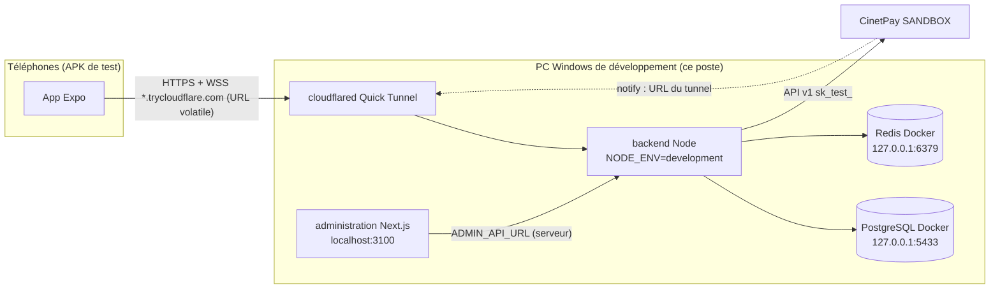
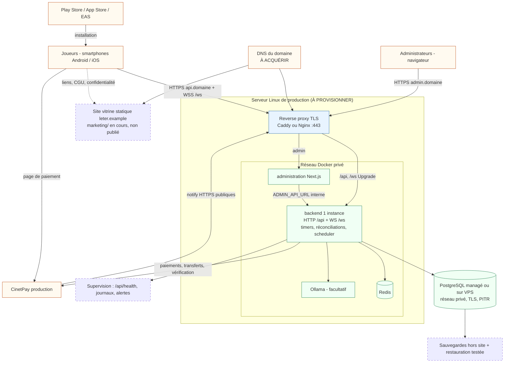
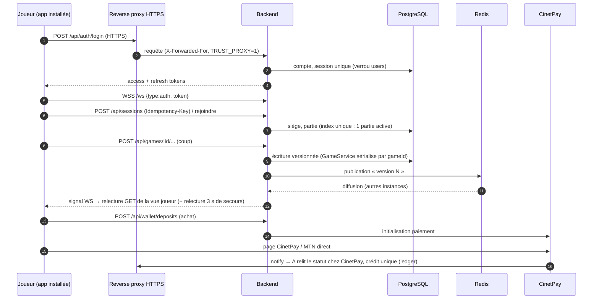

# Le Ter — Cartographie, architecture de production et audit de préparation

- **Date** : 2026-10-26 · **Branche** : `main` (`f428637`, « PRODUCTION du 26/10/2026 »), dépôt
  propre au début de l'audit.
- **Portée** : dépôt local uniquement. Aucun serveur Linux, aucun DNS, aucun compte CinetPay de
  production, aucun téléphone n'ont été examinés : ils ne sont pas accessibles depuis ce poste et
  aucun document du dépôt ne les décrit. Ce qui en dépend est marqué **NON VÉRIFIÉ**.
- **Niveaux de preuve** utilisés : **[C]** inspecté dans le code · **[T]** test automatisé
  exécuté pendant l'audit · **[P]** préproduction · **[R]** appareil ou infrastructure réels.
  Aucun contrôle de niveau [P] ou [R] n'a été réalisé pendant cet audit.

---

## 0. Verdicts par niveau (mise à jour du 2026-10-26, environnement de test)

Le-Ter est **en environnement de test**, sans ouverture publique immédiate. L'absence
d'infrastructure de production n'est donc pas comptée comme un défaut des tests internes.

| Niveau | Verdict | En une phrase |
|---|---|---|
| 1. Préparation aux tests | **PRÊTE SOUS CONDITIONS** | Validée de bout en bout en local (HTTP, WS, PG, Redis), y compris en mode tunnel (loopback, proxy de confiance, callbacks CinetPay). Il reste 2 actions externes : ouvrir le tunnel ngrok (T-1, refusé à l'agent) et la liste blanche IP CinetPay (T-8). Puis APK et téléphones |
| 2. Préparation à la préproduction | **PAS PRÊTE** | Aucune infrastructure proche de la production : serveur, domaine, TLS, proxy WS, PG/Redis gérés, sauvegardes, supervision, CI |
| 3. Préparation à l'ouverture publique | **PAS PRÊTE** | Mêmes manques, plus conformité, documents légaux, CinetPay live, identifiants d'application, décisions métier (§A, §H) |

### 0.1 Niveau 1 — Préparation aux tests

**Contrôles réalisés et résultats exacts**

| Contrôle | Niveau de preuve | Résultat |
|---|---|---|
| Lint + TypeScript (backend, administration, frontend) | [T] | ✔ exit 0 ×6 |
| Tests backend (unitaires + intégration, par dossier) | [T] | ✔ 2 491 distincts, 0 échec |
| Tests frontend (série) | [T] | ✔ 100/100 suites, 1 676/1 676 |
| Tests administration + build | [T] | ✔ 189/189, build exit 0 |
| PostgreSQL réel (base `le_ter_audit_20261026` seulement) : concurrence retraits, paiements plateforme, tournois, sessions, auth, cycle de vie, réclamations | [T] | ✔ 71/71 |
| PostgreSQL réel + Redis réel : événements entre instances, mains privées, timeouts de tour réels, validation fonctionnelle C.6 (2 à 4 joueurs, fuite, arrivée en cours, mains gagnantes, reprises) | [T] | ✔ **10/10** : `redis-user-events` 1, `redis-private-events` 1, `turn-timeout-real-infra` 1, `c6-functional-real-infra` 7 ; `redis-tournament-payouts` (2) **non exécuté** (garde-fou `le_ter_test`) |
| WebSocket réel (`chat-realtime` : vrai serveur HTTP + client `ws`) : `game:changed`, 4401, reconnexion, rattrapage, isolation des parties | [T] | ✔ inclus dans chat 52/52 |
| **Vrai serveur démarré** (`src/server.ts`, port 3999, base jetable, Redis Docker, sans CinetPay) : 57 migrations depuis zéro, `/api/health` | [T] local | ✔ `{"status":"ok","database":"connected","redis":"connected"}` |
| **Parcours de bout en bout à 2 joueurs** sur ce serveur (HTTP + WS) | [T] local | ✔ **21/21** (détail §0.4) |
| Verrou parrainage D-169 | [T] + journal du serveur | ✔ 4 tests ; avertissement « crédit des paliers désactivé » au démarrage ; `REFERRAL_REWARDS_ENABLED` absent de `backend/.env` → `false` |
| CinetPay en sandbox | [C] config | ✔ `sk_test_` seulement (0 `sk_live_`) ; retraits en mode `sandbox` |
| Opérations financières pendant l'audit | — | Simulées : fournisseur simulé dans les tests ; crédit de 5 000 jetons **simulé** dans la base jetable pour le parcours ; aucun appel CinetPay |
| PostgreSQL applicatif (`localhost:5432/le_ter`) et Redis de dev | [R] poste | ✔ PostgreSQL à l'écoute ; Redis `PONG` |
| Backend de test et URL publique de l'application | [R] poste | ✘ backend arrêté ; domaine du Quick Tunnel de `frontend/.env` **inexistant** (NXDOMAIN) ; nouveau tunnel **non ouvert** (permission refusée à l'agent) |
| **Mode tunnel** sur le vrai serveur (`HOST=127.0.0.1`, `TRUST_PROXY=loopback`, URL CinetPay dérivées, clés sandbox de `backend/.env`, base jetable) | [T] local | ✔ parcours **21/21** ; écoute `127.0.0.1` seulement, IP réseau refusée ; limite par IP non falsifiable (429 à la 21ᵉ inscription, autre IP 201) ; callbacks sans effet financier (registre inchangé) ; journal sans secret |
| Tests D-170 + suites impactées (série) | [T] | ✔ unitaires 58/58 suites, 1 172/1 172 ; intégration santé/HTTP/proxy 14/14, paiements 123/123, retraits 70/70 (+9 PG réel ignorés), parrainage 19/19, finance plateforme 26/26 (+2) |
| Téléphones de test, réseaux différents, écrans sur petits téléphones | — | **NON EXÉCUTÉ** (aucun appareil accessible) |

**Constats propres à l'environnement de test : état après la 2ᵉ passe (D-170)**

| ID | Gravité | État | Ce qui a été fait / constaté | Ce qui reste | Validation |
|---|---|---|---|---|---|
| T-1 | **Bloquant tests à distance** | **PRÊT, en attente d'une action** | Cause : Quick Tunnel (URL changeante), domaine NXDOMAIN. Moyens disponibles inventoriés : ngrok installé et **lié à un compte** (domaine gratuit attribué) ; cloudflared sans certificat (pas de tunnel nommé) ; Tailscale sans HTTPS ni Funnel. Commande `npm run dev:tunnel -- <URL>` ajoutée et testée (refus d'URL ✔). **L'ouverture du tunnel par l'agent a été refusée par la politique de permissions de la session** : non contournée | Lancer `ngrok http 127.0.0.1:3000`, puis `npm run dev:tunnel -- <URL ngrok>` ; reconstruire l'APK `preview` avec cette URL | `/api/health` public = `ok/connected/connected` depuis un téléphone en 4G : **NON EXÉCUTÉ** |
| T-2 | **Élevé (tests de paiement)** | **Corrigé dans le mode tunnel** | Les 3 URL (`/api/payments/cinetpay/notify` POST, `/api/payments/cinetpay/return/:paymentId` GET, `/api/withdrawals/cinetpay/notify` POST) sont dérivées de l'URL du tunnel par `dev:tunnel`, routes et méthodes inchangées, `backend/.env` non modifié. Sur le vrai serveur, requêtes sans effet financier : corps vide → 400, paiement ou retrait inconnu → 404, retour → page de redirection vers l'app, identifiant invalide → 400 ; **registre identique avant/après** (10 écritures / 30 398 jetons simulés). Format JSON conforme à la doc v1 | Atteinte par Internet et notification **réelle** du sandbox : **NON VÉRIFIÉES** (pas de tunnel, et T-8) | Premier achat sandbox : `cinetpay notification received` dans le journal |
| T-3 | Moyen | **Corrigé dans le mode tunnel** | `TRUST_PROXY=loopback` imposé par `dev:tunnel` (pas `1`, `true` refusé). Test d'intégration (5/5) et vrai serveur : 20 inscriptions puis **429 à la 21ᵉ** malgré un `X-Forwarded-For` forgé différent à chaque requête ; un autre joueur reste libre (201) | Hors mode tunnel (Tailscale direct), aucun proxy : rien à faire | ✔ [T] |
| T-4 | **Élevé si mal configuré** | **Corrigé** | `readEnv` refuse au démarrage une clé `sk_live_` hors `NODE_ENV=production` (y compris `test`), ainsi qu'une clé et une API d'environnements opposés ; message sans secret ; garde des retraits conservée en seconde barrière. Configuration actuelle de `backend/.env` acceptée (sandbox, `development`) | — | ✔ [T] tests D-170 ; ✔ `readEnv` sur la configuration réelle |
| T-5 | Moyen | **Atténué, pas résolu** | Base `le_ter` : 4 comptes à adresses non réservées (vraisemblablement réelles), 7 positions de géolocalisation, 12 messages, 1 réclamation, 26 paiements et 3 retraits sandbox (comptes agrégés en lecture seule, aucune ligne lue). Rien modifié. Générateur `npm run test:accounts` (comptes `@example.com`, mot de passe fourni par l'environnement, jamais affiché) testé : 4/4 | Décider du sort des 4 comptes réels (consentement des testeurs, ou remplacement par des comptes fictifs) ; chiffrement du disque du poste | Nouveaux tests menés uniquement avec des comptes `@example.com` |
| T-6 | Faible | **Corrigé dans le mode tunnel** | `HOST` facultatif : `127.0.0.1` imposé par `dev:tunnel`. Vrai serveur : écoute `127.0.0.1:3999` seulement ; connexion par l'IP réseau du poste **refusée**. Sans `HOST` : comportement inchangé (nécessaire à Expo Go par Tailscale, `start:tailscale`). Aucune règle de pare-feu modifiée | Mode Tailscale : possibilité `HOST=<IP Tailscale>` pour ne servir que le tailnet (non testé) | ✔ [T] local |
| T-7 | Faible (outillage) | Inchangé | Suites lourdes sur un poste de 8 Go | `--runInBand --forceExit` ; CI à terme | — |
| T-8 | **Bloquant tests de paiement** | **Nouveau** | Au démarrage avec les clés sandbox : `PAYMENT_PROVIDER_ALERT` `PROVIDER_IP_NOT_ALLOWED` (CinetPay 2011, HTTP 422). L'IP publique actuelle du poste n'est pas dans la liste blanche du compte marchand (cas connu, `docs/payments.md` l.403-414). Achats sandbox refusés proprement, rien débité | Ajouter l'IP publique actuelle dans le tableau de bord CinetPay (accès externe requis) | `npm run payments:diagnose` → `authentication: ACCEPTED` |
| — | Vérifié sans risque | — | PostgreSQL applicatif : `0.0.0.0:5432` mais `pg_hba.conf` limité à `127.0.0.1/32` et `::1` (scram-sha-256) ; Docker publié sur `127.0.0.1` ; secret JWT de 64 caractères | — | — |

**Conditions de réussite du niveau 1** (dans l'ordre) :

1. **T-1** (votre action) : `ngrok http 127.0.0.1:3000`, puis vérifier que l'URL est la même au
   2ᵉ lancement.
2. `npm run dev:tunnel -- <URL>` dans `backend/` (T-2, T-3 et T-6 inclus), puis contrôler les
   deux lignes `[dev:tunnel] santé`.
3. **T-8** : IP publique du poste dans la liste blanche CinetPay sandbox, puis
   `npm run payments:diagnose`.
4. Variable EAS `EXPO_PUBLIC_API_URL=<URL>` (environnement `preview`), puis une APK.
5. Comptes fictifs (`npm run test:accounts`), puis la procédure à deux téléphones du §0.6.
6. Grille visuelle §E bis sur un petit Android.

### 0.2 Niveau 2 — Préparation à la préproduction

**Déjà démontré** [T] : migrations depuis zéro, démarrage du vrai serveur avec PG et Redis,
parcours à 2 joueurs, concurrence financière sur PG réel.

**Manque** :

- serveur Linux et Docker Compose (§D) ;
- domaine, DNS et TLS ;
- reverse proxy avec Upgrade WebSocket et délais longs ;
- `NODE_ENV=production` et `TRUST_PROXY=1` ;
- PostgreSQL géré ou isolé avec TLS et un rôle dédié ;
- Redis privé avec mot de passe ;
- sauvegardes et restauration testée ;
- supervision de `/api/health` et alertes ;
- CI qui joue les suites PG et Redis réelles (dont `le_ter_test` pour les paiements de tournoi) ;
- test de charge hors production ;
- plan de retour arrière.

**Condition de réussite** : la même grille que le niveau 1, rejouée sur cette infrastructure
avec CinetPay **sandbox**.

### 0.3 Niveau 3 — Préparation à l'ouverture publique

Les conditions du §A et du §H restent entières :

- identifiants Android/iOS définitifs ;
- CinetPay live, recette, puis petits montants avec rapprochement à zéro écart ;
- documents légaux complétés et relus ;
- avis réglementaire sur le jeu en argent réel (T-07) ;
- décisions R-41, R-05, R-02 ; R-42/R-34 avant `REFERRAL_REWARDS_ENABLED=true` ;
- appareils réels et scénario à distance ;
- supervision et procédures d'incident ;
- site vitrine publié (`marketing/`, partiel).

### 0.4 Parcours de bout en bout exécuté (vrai serveur, 21/21)

Exécuté le 2026-10-26, avec le script hors dépôt `smoke.mjs`, contre `src/server.ts` démarré sur
le port 3999 :

- base `le_ter_audit_20261026` migrée depuis zéro ;
- Redis Docker ;
- aucune clé CinetPay, secret JWT éphémère ;
- répertoire de lancement sans `.env`, pour ne jamais charger la configuration de dev.

Contrôles, tous ✔ :

1. `/api/health` connecté.
2. Inscription et connexion de 2 joueurs.
3. Crédit **simulé** de 5 000 jetons, uniquement dans la base jetable.
4. Route protégée → 401 sans jeton.
5. Création d'une table avec mise de 100.
6. Authentification WebSocket des 2 joueurs.
7. B rejoint la table puis la partie.
8. Abonnement temps réel des deux.
9. Démarrage de la partie.
10. 5 cartes chacun.
11. Vue de A sans aucune carte de B.
12. Fin de la distribution.
13. Coup hors tour → 422.
14. Carte de l'adversaire → 422.
15. Coup valide → 200.
16. `game:changed` reçu par l'adversaire **pour ce coup** (v4 → v5).
17. L'adversaire relit la carte jouée.
18. Même `commandId` rejoué : version inchangée.

Le journal du serveur ne contient aucune erreur, aucun jeton et aucun mot de passe. Le serveur a
été arrêté ensuite.

Ce parcours démontre la chaîne **serveur ↔ PostgreSQL ↔ Redis ↔ WebSocket** en local. Il ne
démontre **pas** l'accès depuis des réseaux différents : il faut T-1 et deux téléphones.

### 0.5 Ce qui n'a PAS été exécuté (2ᵉ passe)

- Ouverture d'un tunnel public (ngrok) : refusée par la politique de permissions de la session.
  Elle n'a pas été contournée, par exemple avec cloudflared.
- Par conséquent, rien n'a été vérifié depuis Internet : santé publique, WebSocket `wss://`,
  callbacks atteints par CinetPay, page d'avertissement ngrok.
- Notification réelle du sandbox CinetPay et achat sandbox de bout en bout : bloqués par T-8, et
  aucun achat lancé.
- Téléphones : aucun appareil accessible.
- `HOST=<IP Tailscale>` : non testé.
- Suites `le_ter_test` (paiements de tournoi, 8 + 2 tests) : garde-fou non contourné.

### 0.6 Procédure à deux téléphones distants (à exécuter)

Préparation : téléphone A en 4G/5G (Wi-Fi coupé), téléphone B sur un Wi-Fi différent de celui
du PC. Comptes fictifs uniquement (`npm run test:accounts`). CinetPay en **sandbox** (`sk_test_`,
refus de démarrage sinon, D-170).

| # | Action | Résultat attendu | Déjà couvert localement ? |
|---|---|---|---|
| 1 | Navigateur du téléphone A : `https://<URL>/api/health` (passer l'avertissement ngrok) | `{"status":"ok","database":"connected","redis":"connected"}` | ✔ local, ✘ Internet |
| 2 | Installer l'APK `preview` sur A et B ; se connecter avec 2 comptes fictifs | Connexion sans erreur réseau | ✔ inscription et connexion (vrai serveur) |
| 3 | A crée une table privée avec mise ; B la rejoint | B voit la table ; A voit B arriver sans rafraîchir | ✔ HTTP + `game:subscribed` |
| 4 | A démarre | 3 + 2 cartes chacun ; aucune carte de l'autre visible | ✔ mains secrètes vérifiées dans la vue serveur |
| 5 | B tente de jouer hors tour ; A joue une carte non autorisée | Refus (l'interface ne permet pas, le serveur répond 422) | ✔ 422 serveur |
| 6 | Le joueur attendu joue | La carte apparaît chez l'autre en moins de 2 s | ✔ `game:changed` v4 → v5 |
| 7 | Couper les données de A 30 s, puis rétablir | Reconnexion automatique, état exact retrouvé | ✔ `chat-realtime` (reconnexion, rattrapage) ; ✘ appareil |
| 8 | B en arrière-plan 1 min, puis retour | État à jour, tour éventuellement joué au timeout | ✔ `turn-timeout-real-infra` ; ✘ appareil |
| 9 | Fin de partie : Poursuivre/Quitter (20 s) | Décision prise en compte des deux côtés | ✔ C.6 |
| 10 | Achat sandbox depuis A (après T-8) | Page CinetPay sandbox ; retour dans l'app ; crédit une seule fois ; `cinetpay notification received` au journal | ✘ (T-8) |
| 11 | Retrait sandbox (après T-8) | Transfert **simulé**, numéro d'inscription, aucun fonds réel | ✔ concurrence PG réel 9/9 ; ✘ sandbox |
| 12 | Arrêter le backend 1 min, puis le relancer | « Impossible de joindre le serveur », puis reprise | ✘ |

Critère de réussite : 1 à 12 réussis et consignés avec date, appareils et réseaux. Jusque-là, le
niveau 1 reste **sous conditions**.

---

## A. Verdict exécutif (ouverture publique)

**Verdict : C — PAS PRÊTE POUR LA PRODUCTION.**

- **Ouverture publique (argent réel)** : non. Plusieurs conditions bloquantes (P1) restent ouvertes
  et ne relèvent pas du code : infrastructure, conformité, CinetPay live, décisions métier.
- **Pilote privé limité** (joueurs connus, CinetPay **sandbox**, parrainage sans crédit, D-169) :
  atteignable dès que les étapes 1 à 5 du §H sont faites. Aucun bloquant de code n'a été trouvé
  pour ce périmètre.

Ce verdict ne vient pas de la qualité du code. Le backend est rigoureux : serveur autoritaire,
idempotence, ledger, réconciliation. Pendant l'audit, il n'y a eu **aucun échec
fonctionnel** (§F) :

- backend : 2 491 tests distincts ;
- vrai PostgreSQL : 71/71 tests de concurrence et d'infrastructure ;
- frontend : 1 676/1 676 ;
- administration : 189/189 tests, plus un build réussi. Le verdict vient de ce qui **n'existe pas encore** :

1. **Aucune infrastructure de production** : le backend tourne sur ce PC Windows de
   développement (`NODE_ENV=development`), exposé par un *Quick Tunnel* Cloudflare dont l'URL
   change à chaque relance (`docs/android-apk-test.md` §6). Aucun Dockerfile, aucun reverse
   proxy, aucun CI, aucune sauvegarde, aucune supervision dans le dépôt.
2. **Argent réel non configuré et non validé** : clés CinetPay **sandbox** (`sk_test_`) ;
   aucune transaction de production n'a jamais été observée ; `CINETPAY_TRANSFERS_LIVE_CONFIRMED`
   non attesté.
3. **Conformité non établie** : jeu en argent réel (FCFA, Mobile Money) sans licence identifiée
   (T-07) ; documents légaux avec repères `[Nom légal de l'éditeur]`, `[Adresse]`… (`LEGAL_INFO`
   entièrement `null`) ; pas de site public pour la politique de confidentialité exigée par les
   stores.
4. **Règles financières ouvertes** (`docs/TODO.md`) : R-42 (récompenses de parrainage
   retirables) combinée à R-34 (téléphone jamais vérifié) ouvre une fraude par création de
   comptes. Elle est **neutralisée par défaut depuis cet audit** (D-169 : crédit des paliers
   désactivé, rien n'est perdu), mais reste bloquante tant que la décision n'est pas prise si le
   parrainage doit être actif au lancement. Restent aussi ouverts R-05 (fuyard à 3/4), R-02
   (Double Kora) et R-41 (retraits bloqués en `RECONCILIATION_REQUIRED`).
5. **Identité d'application** : `android.package = com.anonymous.leter` (défaut Expo, immuable
   après la première publication) ; aucun `ios.bundleIdentifier`.

**Confiance** : élevée pour ce qui est dans le code et les tests ; nulle pour ce qui dépend de
l'infrastructure, de CinetPay en production et des appareils (jamais observés ici).

---

## B. Cartographie du dépôt

Pas de workspace npm : trois applications indépendantes, chacune avec son `package.json`, son
lockfile et ses `node_modules`.

```
le-ter/
├── AGENTS.md                 règles du dépôt (agents et développeurs)
├── backend/                  API Node.js 22 / Express 5 / TypeScript — autorité du jeu et de l'argent
│   ├── src/server.ts         point d'entrée (HTTP + WebSocket /ws sur le même port)
│   ├── src/app.ts            Express : request-id, en-têtes de sécurité, JSON, routes, erreurs
│   ├── src/routes/           montage /api/* (index.ts) — 17 routeurs
│   ├── src/controllers/      validation d'entrée → services (jamais SQL/Redis)
│   ├── src/services/         métier : game, sessions, timers, tournaments, wallet, payments,
│   │                         withdrawals, platform-finance, referrals, complaints, detection, admin
│   ├── src/domain/           règles pures : rules (Fap-Fap), garam, cards, wallet, payments…
│   ├── src/repositories/     ports + implémentations PostgreSQL (`pg`, requêtes paramétrées)
│   ├── src/websocket/        passerelle temps réel `ws` + bus d'événements (Redis Pub/Sub)
│   ├── src/middleware/       auth JWT, rôle, session admin, rate-limit (mémoire ou Redis)
│   ├── src/config/           env.ts (validation stricte, refus en production), database, redis
│   ├── src/cli/              outils d'exploitation (finish-game, payments:diagnose, user:role…)
│   ├── migrations/           57 migrations SQL (0001 → 0057), `npm run db:migrate[:prod]`
│   ├── tests/                Jest + Supertest ; PGlite en mémoire ; tests « réels » sous
│   │                         TEST_DATABASE_URL / TEST_REDIS_URL
│   ├── docker-compose.yml    PostgreSQL 18 + Redis 8 (+ Ollama facultatif) — DÉVELOPPEMENT seulement
│   └── .env.example          liste des variables (aucune valeur réelle)
├── frontend/                 application mobile Expo SDK 57 / React Native 0.86 (paysage)
│   ├── app/                  routes Expo Router (25 fichiers) — voir tableau ci-dessous
│   ├── src/                  components, features, hooks, lib, services (clients API), stores
│   ├── assets/               icônes, polices, sons (4,7 Mo, embarqués dans le build)
│   ├── audio-src/            sources WAV (15 Mo), exclues du build (.easignore)
│   ├── plugins/              plugin de configuration Android (paysage capteur)
│   ├── app.json / app.config.js   configuration Expo ; garde-fou : build EAS refusé sans URL HTTPS publique
│   ├── eas.json              profils development / preview (APK) / production
│   └── android/              GÉNÉRÉ (CNG), ignoré par Git — ne jamais éditer
├── administration/           back-office Next.js 16 / React 19 (BFF), port 3100
│   ├── app/(auth)/connexion  connexion admin
│   ├── app/(dashboard)/      24 pages : tableau-de-bord, joueurs, parties, tournois, finances,
│   │                         paiements, retraits, retraits-plateforme, compte-plateforme,
│   │                         rapprochement, parrainage, réclamations, anti-collusion, audit,
│   │                         erreurs, rapports, paramètres, profil
│   ├── app/api/              Route Handlers : proxy serveur vers le backend, login/logout, SSE
│   ├── proxy.ts              redirections de confort (PAS un contrôle d'accès)
│   └── .env.example          ADMIN_API_URL, ADMIN_PUBLIC_ORIGIN, ADMIN_COOKIE_SECURE
└── docs/                     source de vérité : decisions.md (D-001 → D-168), TODO.md,
                              architecture, paiements, retraits, tournois, admin/, garam/…
```

| Chemin réel | Rôle | Module | Technologie | Point d'entrée | Déployé où | Public / privé |
|---|---|---|---|---|---|---|
| `backend/` | API, règles, argent, temps réel, tâches planifiées | Backend | Node 22, Express 5, TS, `pg`, `redis`, `ws` | `src/server.ts` → `dist/server.js` | Serveur Linux (conteneur), derrière reverse proxy | **Public** via HTTPS (`/api`, `/ws`) |
| `backend/migrations/` | Schéma PostgreSQL | Base | SQL | `npm run db:migrate:prod` | Exécuté contre l'instance PostgreSQL au déploiement | — |
| *(instance PostgreSQL)* | Données (source de vérité, D-022) | Base | PostgreSQL 18 | — | Dev : conteneur `backend-postgres-1` (127.0.0.1:5433). Prod : **à créer** | **Privé** |
| *(instance Redis)* | Pub/Sub temps réel, rate-limit partagé | Infra | Redis 8 | — | Dev : `backend-redis-1`. Prod : **à créer** | **Privé** |
| `frontend/` | Application des joueurs | Mobile | Expo 57, RN 0.86, expo-router, TanStack Query, zustand | `expo-router/entry`, `app/_layout.tsx` | **Sur les téléphones** (EAS Build → Play Store / App Store) | — (client) |
| `administration/` | Back-office | Admin | Next.js 16, Tailwind 4, React Query | `app/layout.tsx`, `next start` | Serveur Node (même VPS possible) | Public restreint (`admin.<domaine>`) |
| `frontend/app/admin/**` | Anciens écrans admin mobiles | Mobile | — | — | Embarqués dans l'APK, sans lien | Reçoivent 401 `ADMIN_SESSION_REQUIRED` (docs/admin/SECURITY.md) |
| `frontend/app/legal/[document].tsx` | CGU / confidentialité **dans l'app** | Mobile | — | — | Téléphone | — |
| `marketing/` *(non suivi par Git)* | Site vitrine FR/EN en cours, créé **par une autre session** pendant l'audit | Vitrine | HTML/CSS/JS statiques, Node pour les scripts, aucune dépendance | `scripts/build.mjs` → `dist/` | Hébergement statique (CDN) **à prévoir** | Public (pas encore publié, `INDEXABLE = false`) |
| *Ollama* (compose, profil `ai`) | Assistant des réclamations (facultatif) | Infra | Ollama | — | Même réseau privé que le backend | **Privé** |
| `docs/` | Spécifications, décisions | Docs | Markdown, PDF, DOCX | — | Non déployé | — |

### Écrans mobiles (routes réelles)

`index` (Accueil connecté : HUD, Partie privée, Tournois, Profil, Réglages, Boutique/Retrait en
panneaux), `(auth)/login`, `(auth)/register`, `(auth)/forgot-password`, `game/[gameId]` (table
Fap-Fap et GARAM TIA, fin de partie, Poursuivre/Quitter), `tournament/index`, `tournament/propose`,
`tournament/[tournamentId]`, `tournament/results/index`, `tournament/results/[tournamentId]`,
`support/index` (assistant, réclamations, parrainage), `support/[complaintId]`,
`legal/[document]`, `payment/return` (retour CinetPay `leter://payment/return`), `admin/**`
(obsolète), `dev/cards` (redirige vers l'accueil hors `__DEV__`).

---

## C. Architecture et communications

### C.1 Architecture actuelle (constatée)



### C.2 Architecture cible recommandée



### C.3 Parcours d'un joueur distant



### C.4 Communications

- **Mobile → backend** : HTTPS REST (`EXPO_PUBLIC_API_URL`, inliné au build) + WebSocket
  `/ws` sur la même origine (authentification par première trame, ping de vie). Le temps réel
  n'envoie que des **signaux de version** ; l'état est toujours relu par HTTP (D-101), avec une
  relecture périodique de 3 s (partie, session) comme filet de sécurité.
- **Backend → PostgreSQL** : pool `pg` (max 10, `statement_timeout` 10 s). Écrire d'abord en base.
- **Backend → Redis** : Pub/Sub (événements de partie, utilisateur, admin) et compteurs de
  rate-limit partagés. Panne Redis tolérée (diffusion locale, D-024).
- **Administration → backend** : uniquement côté serveur Next.js (`ADMIN_API_URL`) ; le
  navigateur ne parle qu'à Next.js (cookies HttpOnly, contrôle CSRF par origine).
- **Backend ↔ CinetPay** : appels sortants HTTPS (paiement, statut, transferts) ; notifications
  entrantes sur `POST /api/payments/cinetpay/notify`, `/api/withdrawals/cinetpay/notify`,
  `/api/platform-payouts/cinetpay/notify` — **toujours re-vérifiées** auprès de CinetPay avant
  tout crédit/débit.
- **Site vitrine** : inexistant.

---

## D. Plan de déploiement de production

Recommandation : **un serveur Linux (VPS) avec Docker Compose** pour le pilote — reverse proxy
TLS, backend, administration, Redis — et **PostgreSQL managé** (sauvegardes et PITR fournis) dans
la même région. Le backend doit rester **à une seule instance** tant que T-08 (affinité des
timers par `gameId`) n'est pas tranché.

| Composant | Cible de déploiement | Domaine / accès | Obligatoire ? | Pourquoi | État actuel | Action restante |
|---|---|---|---|---|---|---|
| App mobile (`frontend/`) | Téléphones, via EAS Build → Play Console (test interne → production), App Store Connect/TestFlight | — | Oui | Le jeu est joué depuis l'app ; rien à héberger | APK `preview` de test vers un Quick Tunnel | `android.package` et `ios.bundleIdentifier` définitifs ; `EXPO_PUBLIC_API_URL=https://api.<domaine>` dans l'environnement EAS `production` ; build `production` (AAB) |
| Backend (`backend/`) | Conteneur sur le VPS, 1 instance, `NODE_ENV=production` | `https://api.<domaine>` (`/api`, `/ws`) | Oui | Autorité des règles, comptes, argent, timers, temps réel | PC de dev + tunnel | Dockerfile, `npm run build`, `db:migrate:prod`, `TRUST_PROXY=1`, redémarrage auto, `/api/health` supervisé |
| Reverse proxy | Caddy/Nginx sur le VPS, seuls ports 80/443 ouverts | `api.` et `admin.` | Oui | TLS, routage, Upgrade WebSocket, délais longs pour `/ws` et SSE admin | Absent | Config avec `Upgrade`/`Connection`, timeouts ≥ 60 s, taille de corps alignée sur le backend |
| PostgreSQL | Managé (même région) ou conteneur sur le VPS **sans port publié** | Réseau privé, TLS | Oui | Source de vérité (D-022) | Docker local de dev | Rôle dédié, mot de passe fort, `sslmode`, sauvegardes + test de restauration |
| Redis | Conteneur sur le VPS, réseau privé, mot de passe | Privé | Recommandé (indispensable dès 2 instances) | Pub/Sub, rate-limit partagé | Docker local | `requirepass`, pas de persistance nécessaire |
| Administration (`administration/`) | Conteneur Node (`next build` + `next start`) sur le VPS | `https://admin.<domaine>`, idéalement restreint (IP, Cloudflare Access ou VPN) | Oui pour exploiter | Retraits, réconciliation, modération, tournois | Local | `ADMIN_API_URL` interne (`http://backend:3000`), `ADMIN_PUBLIC_ORIGIN`, cookies `Secure` |
| CinetPay | Externe | Callbacks vers `api.<domaine>` | Oui si achats/retraits | Paiements Mobile Money | Sandbox | Clés `sk_live_`, URLs notify HTTPS ≤ 120 caractères, transferts activés et approvisionnés, puis `CINETPAY_TRANSFERS_LIVE_CONFIRMED=true` |
| Tâches asynchrones | **Dans le processus backend** (DeadlineSupervisor, TournamentScheduler, réconciliations paiements/retraits, parrainage) | — | Oui | Timers de tour 20 s, fin des tournois, crédits en attente | En place | Aucun worker séparé à créer ; superviser le processus unique |
| Ollama | Conteneur facultatif, privé | — | Non | Assistant réclamations (mode dégradé sinon) | Profil `ai` | Optionnel (≈ 2–4 Go RAM) |
| Site vitrine | Hébergement statique (CDN) | `https://<domaine>` | Oui pour l'ouverture publique (politique de confidentialité, liens stores, `REFERRAL_DOWNLOAD_URL`) | Exigences stores, parrainage | **Partiel** : `marketing/` (autre session, non suivi) | Liens stores, informations légales, domaine, hébergement, indexation |
| Supervision / sauvegardes | Uptime externe sur `/api/health`, journaux conteneurs, page admin « Erreurs » | — | Fortement recommandé | Détection des pannes, incidents financiers | Partiel (table `server_errors`, page admin) | Alertes, rotation des journaux, sauvegardes hors site |

Ports : public **443** (et 80 → redirection). Privés : 3000 (backend), 3100 (admin), 5432, 6379,
11434. Ne jamais publier PostgreSQL ni Redis.

Ressources indicatives pour un pilote : VPS 2–4 vCPU / 4–8 Go (sans Ollama). Non mesurées :
aucun test de charge n'a été exécuté.

---

## E. Site vitrine

**Verdict : site vitrine partiellement présent, non déployable en l'état.**

- Au début de l'audit (commit `f428637`), il n'y avait **aucun** site vitrine dans le dépôt.
- Pendant l'audit, une **autre session** a créé `marketing/`, non suivi par Git et non modifié
  par cet audit. C'est un site statique FR/EN sans dépendance : accueil, CGU, politique de
  confidentialité, mentions légales, gestion de `?ref=` pour le parrainage, `.htaccess`, et un
  build vers `dist/`. Le contenu est observé en lecture seule.
- Ce qui manque avant publication :
  - liens Android et iOS vides (`public/assets/js/config.js`), ainsi que `supportUrl` et
    `supportEmail` ;
  - repères juridiques `[Nom légal de l'éditeur]` / `[Adresse]` encore présents dans les CGU et
    la politique de confidentialité ;
  - `INDEXABLE = false` ;
  - aucun domaine ni hébergement ;
  - aucune entrée correspondante dans `docs/decisions.md` constatée.
- Il ne dépend ni du backend ni de l'administration : un hébergement statique (CDN) sur le
  domaine racine suffit. C'est lui qui devra porter l'URL de politique de confidentialité exigée
  par les stores et la page `REFERRAL_DOWNLOAD_URL`.
- Les CGU et la politique de l'application restent dans `frontend/src/features/legal/content/`,
  avec les mêmes repères à compléter.

---

## E bis. Stabilisation des écrans

**Déjà en place avant l'audit**, inspecté [C] et couvert par des tests [T] :

- Transition `fade` unique pour toutes les piles (`stack-options.ts`). Le glissement et le zoom
  Android par défaut faisaient « bouger » l'écran.
- Fond opaque couleur table pendant les transitions.
- Polices préchargées avant le premier écran (`FontCurtain`).
- Marges de sécurité lues au premier rendu (`useSafeAreaInsets` plutôt que `SafeAreaView`).
- Gabarit calculé sur la vue racine (`useLandscapeViewport`).
- Panneaux exclusifs opaques (D-126) ; HUD fixe (D-133) ; Profil sans défilement (D-162).
- Chargements et erreurs affichés dans la zone de contenu, sous un en-tête fixe.
- Administration : coquille fixe, `scrollbar-gutter: stable` (pas de décalage horizontal entre
  une page courte et une page longue), `next/font` avec `display: swap`.

**Corrigé pendant l'audit** [C][T] :

- **Cause** : Connexion, Inscription, Mot de passe oublié (`AuthScreen`) et Aide et
  réclamations (`SupportScreen`) utilisaient `KeyboardAvoidingView` avec
  `behavior = undefined` sur Android. Or D-132 a constaté qu'en affichage bord à bord, la fenêtre
  n'est pas redimensionnée : le clavier recouvrait le bas de l'écran (champ actif, bouton
  d'envoi). Les panneaux (`LobbyPanel`) et la boutique (`ShopFlow`) utilisaient déjà `height`.
- **Correction** : une seule valeur, `keyboardAvoidingBehavior` (`frontend/src/lib/keyboard.ts`),
  pour les 4 écrans. Deux écrans ne réagissent plus différemment au même clavier.
- **Tests** : `tsc` ✔, `expo lint` ✔, `src/features/auth` 67/67 ✔.

**Non validé visuellement** : aucun émulateur ni téléphone n'a été utilisé. À contrôler sur un
petit et un grand Android, puis un iPhone :

1. Ouvrir le clavier sur Connexion, Inscription, Mot de passe oublié, Assistance, Proposer un
   tournoi, Boutique et Retrait : le champ actif et le bouton d'action restent visibles, et rien
   ne saute à la fermeture.
2. Naviguer Accueil ↔ Tournois ↔ Résultats ↔ Assistance ↔ table : aucun décalage à l'arrivée.
3. Ouvrir Profil sur un écran de 360 dp de haut : « Aide et réclamations » et « Déconnexion »
   sont visibles sans défiler.
4. Proposer un tournoi, clavier fermé : « Enregistrer » et « Proposer » sont visibles.
5. Pendant une partie : arrivée des cartes, minuteur et fin de partie sans déplacement parasite.

## F. État des validations

**Conditions.** Poste Windows de 8 Go, entre 30 et 400 Mo de RAM libre selon le moment : la VM
WSL de Docker, les navigateurs et une autre session Claude restent actifs. Toutes les suites ont
donc été lancées **une par une** (`--runInBand`, plafond de tas Node). Rien n'a été désactivé ni
modifié pour forcer un résultat vert.

### F.1 Backend (`backend/`)

| Commande | Résultat |
|---|---|
| `npm run lint` | ✔ exit 0 |
| `npm run typecheck` | ✔ exit 0 (après les changements D-169) |
| `npm test -- tests/unit/referrals tests/integration/referrals --runInBand --forceExit` | ✔ 3/3 suites, **35/35** (dont les 4 nouveaux tests D-169 et « événements répétés, évaluations concurrentes et redémarrage : chaque palier une seule fois ») |
| `npm test -- tests/unit --runInBand --forceExit` | ✔ **57/57 suites, 1 152/1 152** |
| `npm test -- tests/integration/<dossier> --runInBand --forceExit`, 18 dossiers un par un | ✔ **1 320 réussis, 0 échec, 0 timeout, 96 ignorés** (102 suites) — détail ci-dessous |
| `npm test -- --runInBand` (suite complète en un seul run) | ⚠ **NON CONCLUANT**, arrêté. Les 10 premières suites ont échoué par « Exceeded timeout of 30000 ms for a hook » (création de PGlite et des 57 migrations dans `beforeAll`, délai `PGLITE_TIMEOUT_MS` codé en dur) avec 44 Mo de RAM libre, suivis d'erreurs `undefined` en cascade. Ce n'est pas un échec fonctionnel : les mêmes suites passent toutes en exécution par dossier. |

Intégration par dossier (réussis / ignorés) :

| Dossier | Réussis / ignorés |
|---|---|
| health | 2 / 0 |
| http-foundation | 7 / 0 |
| admin | 81 / 0 |
| auth | 91 / 5 |
| chat | 52 / 0 |
| complaints | 48 / 8 |
| database | 41 / 0 |
| detection | 154 / 0 |
| game | 77 / 0 |
| games | 183 / 16 |
| realtime | 0 / 4 |
| sessions | 98 / 23 |
| timers | 6 / 0 |
| tournaments | 236 / 29 |
| wallet | 25 / 0 |
| payments | 123 / 0 |
| withdrawals | 70 / 9 |
| platform-finance | 26 / 2 |

Les tests ignorés sont **exclusivement** les suites « infrastructure réelle » qui ne s'exécutent
qu'avec `TEST_DATABASE_URL`, `TEST_REDIS_URL` ou `RUN_REAL_AI_TESTS`.

### F.2 Concurrence sur un vrai PostgreSQL

- **Base** : `le_ter_audit_20261026`, créée pour l'audit sur le conteneur Docker de dev
  (`127.0.0.1:5433`, identifiants factices de `docker-compose.yml`). Avant exécution, elle était
  vide (0 table) et distincte de la base applicative, une autre instance (`localhost:5432/le_ter`),
  vérifiée sans afficher de secret. Chaque suite travaille dans un schéma temporaire supprimé à la
  fin.
- **Fournisseurs** : CinetPay **simulé** ; aucun appel réseau, aucune transaction réelle.

| Suite | Résultat |
|---|---|
| `withdrawals/postgres-withdrawal-concurrency` | ✔ **9/9** : quota sur 2 instances, solde juste suffisant, même `Idempotency-Key` ×10, remboursements concurrents, notification et réconciliation simultanées, reprise après redémarrage, échec réseau |
| `platform-finance/postgres-platform-payout-concurrency` | ✔ 2/2 |
| `tournaments/postgres-tournament-concurrency` | ✔ 6/6 |
| `auth/postgres-concurrency` | ✔ 5/5 |
| `sessions/postgres-session-concurrency` | ✔ 21/21 |
| `tournaments/postgres-tournament-payouts` | **NON EXÉCUTÉ** (8) : son garde-fou exige une base nommée `le_ter_test` ; garde-fou non contourné |
| `games/postgres-lifecycle-concurrency` | ✔ 8/8 |
| `tournaments/postgres-tournament-closure` | ✔ 3/3 |
| `tournaments/postgres-tournament-pre-registration` | ✔ 10/10 |
| `sessions/postgres-seat-preservation` | ✔ 2/2 |
| `complaints/postgres-complaints` | ✔ 5/5 |
| **Total exécuté sur PostgreSQL réel** | ✔ **71/71**, 0 schéma résiduel après exécution |
| Avec Redis réel (`TEST_REDIS_URL=redis://127.0.0.1:6379`, Redis Docker volatil, aucun vidage) : `c6-functional-real-infra` 7/7, `turn-timeout-real-infra` 1/1, `redis-private-events` 1/1, `redis-user-events` 1/1 | ✔ **10/10** (2ᵉ passe de l'audit) |
| `realtime/redis-tournament-payouts` | **NON EXÉCUTÉ** (2) : garde-fou `le_ter_test` |
| `complaints/ollama-real` | **NON EXÉCUTÉ** : modèle réel interdit en test (D-114) |

### F.3 Administration (`administration/`)

| Commande | Résultat |
|---|---|
| `npm run lint` | ✔ exit 0 |
| `npm run typecheck` | ✔ exit 0 |
| `npx vitest run --no-file-parallelism --maxWorkers=1` | ✔ **25/25 fichiers, 189/189** |
| `npm run build` (local, aucun déploiement) | ✔ exit 0, 24 pages et le proxy compilés |

### F.4 Frontend (`frontend/`)

| Commande | Résultat |
|---|---|
| `npx tsc --noEmit` | ✔ exit 0 (après la correction clavier) |
| `npx expo lint` | ✔ exit 0 |
| `npx jest` (parallèle, 1er run) | 97/100 suites, 1 668/1 676 ; les 8 échecs visibles sont des **timeouts** (« Exceeded timeout of 30000 ms ») |
| `npx jest src/features/auth --runInBand` | ✔ **6/6 suites, 67/67** en 64 s ; ForgotPassword, en échec au 1er run, passe seul (8/8). Jest ne rend pas la main après la fin (poignée asynchrone ouverte, P3) : d'où `--forceExit` ensuite |
| `npx jest --runInBand --forceExit` (relance complète, série) | ✔ **100/100 suites, 1 676/1 676**, exit 0 : les 8 échecs du 1er run étaient tous des timeouts dus aux ressources |

### F.5 Synthèse

| Catégorie | Constat |
|---|---|
| Réussis | backend 1 152 unitaires + 1 320 intégration + 19 intégration parrainage (= 2 491 distincts), PG réel 71, administration 189, frontend 1 676 ; lint ✔ et TypeScript ✔ sur les 3 applications ; build admin ✔ |
| Échecs fonctionnels | **aucun** |
| Timeouts dus aux ressources | frontend 1er run (8 tests, tous verts en série) ; backend suite complète en un run (hooks PGlite) : non concluant, verts par dossier |
| Ignorés | 96 tests « infrastructure réelle » dans les runs PGlite (dont 71 exécutés à part, sur PG réel) |
| Non exécutés | `postgres-tournament-payouts` (8, garde-fou `le_ter_test`) ; `redis-tournament-payouts` (2, même garde-fou) ; `ollama-real` ; build EAS mobile (cloud, compte requis) ; build backend `npm run build` (couvert par `tsc --noEmit`, non relancé) |

### F.6 Impossible ici, faute d'accès

- Appareils Android et iOS réels : transitions, clavier, petits écrans, orientation.
- Serveur, DNS, TLS, reverse proxy et WebSocket en production.
- CinetPay live : paiements, transferts, notifications publiques.
- Test de charge.
- Sauvegarde et restauration.

---

## G. Anomalies et risques

| ID | Priorité | Description | Preuves | Scénario / impact | Correction | Validation |
|---|---|---|---|---|---|---|
| PR-01 | **P1** | Aucune infrastructure de production : backend sur PC de dev via Quick Tunnel | `docs/android-apk-test.md` §5-6 ; `backend/.env` `NODE_ENV=development` ; aucun Dockerfile / proxy / CI | PC éteint ou tunnel relancé = application morte pour tous, nouvelle APK requise | VPS + domaine + reverse proxy (§D) | `https://api.<domaine>/api/health` → `ok/connected/connected` depuis la 4G |
| PR-02 | **P1** | Conformité jeu d'argent non établie | T-07 (`docs/TODO.md`) | Risque juridique, retrait des stores | Avis juridique, licence dans les pays visés, politique des stores (jeux d'argent réel) | Validation écrite externe |
| PR-03 | **P1** | Documents légaux incomplets, pas de politique de confidentialité publique | `frontend/src/constants/app-config.ts` `LEGAL_INFO` tout `null` | Refus Play Store/App Store ; non-conformité données personnelles (géolocalisation, téléphone) | Fournir les informations, relecture juridique, publication sur le site | CGU sans crochets, URL publique |
| PR-04 | **P1** (atténué) | Fraude par parrainage : récompenses retirables + téléphone jamais vérifié | R-42, R-34, R-44 (4) ; campagne semée `ACTIVE` (`0056_referral_program.sql` l.52) ; voir §G.1 | 10 faux comptes, achats payés par le parrain, jetons reperdus contre lui, retrait des jetons + 5 000 du palier : ≈ +50 % par cycle, sans plafond | **Protection ajoutée (D-169)** : `REFERRAL_REWARDS_ENABLED=false` par défaut, paliers retenus, crédités à l'activation. Reste : décider R-42/R-34 | Tests D-169 verts ; décision écrite avant `true` |
| PR-05 | **P1** | Argent réel jamais validé de bout en bout | clés `sk_test_` ; `CINETPAY_TRANSFERS_LIVE_CONFIRMED` absent ; R-38 à R-41 | Crédit/retrait incorrect, retraits bloqués sans issue (R-41) | Recette sandbox complète puis petits montants réels contrôlés ; décider R-41 | Rapprochement admin à zéro écart |
| PR-06 | **P1** | Identité d'application provisoire | `app.json` `android.package: com.anonymous.leter`, nom `le-ter`, pas de `ios.bundleIdentifier` | Impossible de changer après la 1re publication | Choisir l'identifiant définitif (ex. `cm.leter.app`) avant tout build store | Build `production` signé |
| PR-07 | **P1** (config) | `TRUST_PROXY` vide derrière un proxy | `backend/src/config/env.ts`, `.env.example` | Tous les joueurs partagent l'IP du proxy → limites de débit atteintes collectivement (connexion bloquée) | `TRUST_PROXY=1` (un saut) en production | Deux IP distinctes vues dans les journaux |
| PR-08 | **P2** | Règles métier ouvertes ayant un effet financier | R-02 (Double Kora), R-05 (fuyard à 3/4), R-13 (mise des parties privées) | Contestations de joueurs | Décisions du porteur du projet | Décisions + tests |
| PR-09 | **P2** | Backend limité à une instance | T-08 ; timers en mémoire réarmés par `DeadlineSupervisor` | Deux instances = timers dupliqués (protégés par version, mais non conçu pour) | Rester à 1 instance ; trancher T-08 avant de scaler | — |
| PR-10 | **P2** | Charge de relecture périodique | `GAME_REFRESH_MS = 3000`, `SESSION_REFRESH_MS = 3000`, `DECISION_REFRESH_MS = 1000` | ~0,7 req/s par joueur à table en plus des signaux WS ; pool PG de 10 | Test de charge en préproduction ; allonger le filet de secours quand le WS est connecté | Mesure p95 et connexions PG |
| PR-11 | **P2** | Pas de sauvegarde ni restauration documentées/testées | aucun script ; TODO.md l.150 | Perte de soldes et ledger | PITR managé ou `pg_dump` + WAL hors site ; exercice de restauration | Restauration réussie sur une base vierge |
| PR-12 | **P2** | Tests sur vrai PostgreSQL/Redis jamais exécutés en CI | TODO.md l.130 ; pas de `.github/` | Régression de concurrence non détectée | CI avec services PG/Redis et `TEST_DATABASE_URL` | Pipeline vert |
| PR-13 | **P2** | Écrans `frontend/app/admin/**` obsolètes embarqués | `docs/admin/SECURITY.md` §2 (401 attendu) | Aucun risque de sécurité (refus serveur), code mort | Retirer dans un lot dédié | — |
| PR-14 | **P2** | Clavier : connexion/inscription et assistance n'appliquaient pas D-132 sur Android | §E bis | Champ ou bouton d'envoi masqué par le clavier en bord à bord | **Corrigé** (`src/lib/keyboard.ts`) | Grille §E bis sur appareil Android réel |
| PR-14b | **P2** | Stabilité visuelle jamais observée sur un appareil | §E bis, §F.6 | Régression d'affichage découverte par les joueurs | Grille §E bis sur 2 Android et 1 iPhone | Captures avant/après, aucun saut |
| PR-14c | **P3** | Suites de tests fragiles sous faible mémoire | §F.1, §F.4 : timeouts des hooks PGlite à 30 s ; Jest frontend qui ne rend pas la main | Faux rouges en CI sur une petite machine | CI avec ≥ 4 Go dédiés ; rechercher la poignée ouverte (`--detectOpenHandles`) | Suite complète verte en un seul run |
| PR-14d | **P3** | Suite `postgres-tournament-payouts` liée au nom `le_ter_test` | `tests/integration/tournaments/postgres-tournament-payouts.test.ts` l.59 | Paiements de tournoi jamais testés sur PG réel en dehors de cette base précise | Base `le_ter_test` dédiée en CI | 8/8 sur PG réel |
| PR-15 | **P3** | Accès admin exposé sur Internet sans restriction réseau | `administration/` ; garde serveur en place | Surface d'attaque (bruteforce limité par rate-limit) | Restreindre `admin.` (IP, Access, VPN) | — |
| PR-16 | **P3** | Notifications push absentes | T-02 | Joueur non prévenu d'un tour de tournoi | `expo-notifications` (nouveau build) | — |

### G.1 Parrainage : analyse d'abus (R-42, R-34)

Chemins concernés : `POST /api/auth/register` (`referralCode`, attribution dans la transaction de
création du compte, garde `xmin`) → règlement d'un achat `wallet_transactions` `deposit`
`succeeded` (déclencheur → `referral_evaluation_queue`) → `ReferralService.processQueue` /
`GET /api/referrals/me` → `PostgresReferralRepository.evaluate` (verrou `referral_codes FOR
UPDATE`, qualification, `creditTier` : `wallet_transactions` `referral_reward` + solde +
`referral_rewards`) → `POST /api/withdrawals` (seul `tokens` est lu ; numéro d'inscription).

| Vecteur | Possible ? | Preuve |
|---|---|---|
| Double crédit d'un palier (évaluations concurrentes, notification rejouée, deux instances) | **Non** | clé `referral-reward:<campagne>:<parrain>:<palier>` unique, `UNIQUE (campaign_id, referrer_id, tier)`, déclencheur différé `referral_reward_requires_tier`, verrou du parrain ; test « évaluations concurrentes » [T] |
| Crédit d'un montant choisi par le client | **Non** | aucune route ne reçoit de montant de récompense [C] |
| Rattacher un compte existant comme filleul / s'auto-parrainer | **Non** | garde `xmin` + `CHECK` d'auto-parrainage (D-161) [C] |
| Qualification sans argent réel (achat en attente, échoué) | **Non** | seuls les `deposit` `succeeded` comptent [C][T] |
| **Faux filleuls** avec des numéros non vérifiés, achats payés par le parrain | **Oui** | R-34 : `phone_verified` toujours faux ; un numéro par compte (`users_phone_key`) mais jamais prouvé |
| **Recycler** les achats des faux filleuls vers le parrain puis tout retirer | **Oui** | parties privées entre complices (détection facultative, absente en GARAM D-144) ; R-42 : `referral_reward` retirable |

Protection appliquée (D-169) : crédit des paliers désactivé par défaut ; aucune règle métier
inventée, rien de perdu (paliers retenus, crédités à l'activation). **Condition bloquante du
lancement public** si le parrainage doit être actif : décisions R-42, R-34 (et R-43 pour la
comptabilité), puis `REFERRAL_REWARDS_ENABLED=true`.

Aucun **P0** confirmé dans le code inspecté. Contrôles positifs constatés **[C]** : identité
toujours tirée du JWT ; opérateur de retrait **ignoré du corps** (`parseWithdrawalInput` ne lit
que `tokens`, D-163) ; `Idempotency-Key` exigée sur les créations de parties, sessions,
dépôts, retraits, paiements de la plateforme ; notifications CinetPay re-vérifiées auprès du
fournisseur avec comparaisons en temps constant ; `readEnv` refuse de démarrer en production
sans `DATABASE_URL`/`JWT_SECRET` ou avec des URLs de notification privées ; toutes les routes
`/api/admin/*` passent par la garde rôle `admin` + session d'administration (8 h / 30 min) du
routeur admin monté en premier ; PostgreSQL et Redis de dev publiés sur 127.0.0.1 seulement.

---

## H. Plan d'action vers la production

1. **Bloquants** : décider R-42/R-34 (ou garder le parrainage suspendu), R-41, R-05 ; choisir
   l'identifiant d'application ; ouvrir l'avis juridique (T-07).
2. **Interfaces** : vérifier sur deux téléphones Android réels (petit et grand écran) et un
   iPhone la grille du §Stabilisation (clavier sur Connexion, Inscription, Assistance, Proposer
   un tournoi, Boutique ; transitions ; Profil sans défilement).
3. **Comptes et argent** : recette sandbox complète (achat page + MTN direct, retrait, échec,
   notification perdue → réconciliation) ; puis clés live et petits montants avec rapprochement.
4. **Backend et multijoueur** : exécuter les tests « réels » (`TEST_DATABASE_URL`,
   `TEST_REDIS_URL`) en CI ; dérouler le plan de test à deux téléphones distants
   (`docs/android-apk-test.md` §7) contre la préproduction.
5. **Domaines et réseau** : acheter le domaine ; DNS `api.`, `admin.`, racine ; reverse proxy TLS
   avec WebSocket ; `TRUST_PROXY=1`.
6. **Données** : PostgreSQL de production (rôle dédié, TLS), `db:migrate:prod`, Redis privé avec
   mot de passe, sauvegardes hors site + restauration testée, supervision de `/api/health`.
7. **CinetPay production** : URLs notify publiques, transferts activés et approvisionnés,
   `CINETPAY_TRANSFERS_LIVE_CONFIRMED=true` seulement après l'étape 3.
8. **Préproduction** : même stack, données de test, test de charge (hors production).
9. **Builds et distribution** : variables EAS `production`, AAB → Play Console test interne →
   test fermé ; TestFlight pour iOS.
10. **Lancement** : pilote privé (joueurs connus, plafonds de retrait bas via
    `PATCH /admin/settings/withdrawal-limit`) → ouverture publique quand PR-01 à PR-07 sont clos.

---

## I. Réponses finales

1. **Où est chaque composant ?** API et jeu dans `backend/` (`src/server.ts`) ; schéma dans
   `backend/migrations/` ; application mobile dans `frontend/` (`app/` pour les routes) ;
   back-office dans `administration/` ; site vitrine en cours dans `marketing/` (non suivi par
   Git, autre session) ; spécifications dans `docs/`. Les instances PostgreSQL et Redis ne sont
   pas dans le dépôt (aujourd'hui : Docker et PostgreSQL locaux de développement).
2. **Que déployer pour jouer à distance ?** Le minimum : backend (HTTPS + WSS), PostgreSQL,
   reverse proxy TLS et domaine, plus l'app mobile construite avec l'URL de production. Redis
   est fortement recommandé ; l'administration est nécessaire pour exploiter (retraits,
   réconciliation, modération).
3. **Où héberger ?** Un VPS Linux sous Docker Compose (proxy, backend en **une instance**,
   administration, Redis) et PostgreSQL managé avec PITR dans la même région. Le site vitrine va
   sur un hébergement statique. L'app va sur les stores via EAS (§D).
4. **Public ou privé ?** Publics : `api.<domaine>` (`/api`, `/ws`, notifications CinetPay), le
   site vitrine, et `admin.<domaine>` (à restreindre au réseau, contrôle serveur déjà en place).
   Privés : PostgreSQL, Redis, Ollama, ports 3000 et 3100.
5. **Le site vitrine existe-t-il ?** Partiellement. Il est apparu pendant l'audit dans
   `marketing/` (autre session) ; liens, informations légales, domaine et indexation manquent.
6. **Ce qui manque :**
   - serveur de production, domaine, DNS, TLS, proxy WebSocket, `TRUST_PROXY=1` ;
   - PostgreSQL et Redis de production, sauvegardes et restauration testée ;
   - supervision et CI ;
   - clés CinetPay live et URLs de notification publiques ;
   - identifiants d'application définitifs ;
   - informations légales et avis juridique ;
   - variables EAS `production`.
7. **Les écrans sont-ils stables ?** Dans le code et les tests, oui : la cause clavier restante
   a été corrigée et le frontend passe 1 676/1 676. Mais **aucune observation sur appareil** :
   ce n'est pas validé visuellement (grille §E bis).
8. **Le portefeuille et les paiements sont-ils sûrs ?** Le code est solide et vérifié :
   idempotence, re-vérification des notifications, opérateur déduit par le serveur, 71/71 tests
   sur PostgreSQL réel dont 9/9 pour les retraits concurrents. Il **n'a jamais été validé avec
   CinetPay en production**. R-41 (sortie de `RECONCILIATION_REQUIRED`) et R-42/R-34
   (parrainage, neutralisé par D-169) restent ouverts.
9. **Le multijoueur est-il prêt pour Internet ?** L'architecture l'est : serveur autoritaire,
   WS + relecture HTTP, échéances persistées, concurrence testée sur PG réel. Mais il n'a jamais
   tourné sur une infrastructure permanente : seulement via un Quick Tunnel depuis ce PC. Il n'y
   a ni test de charge ni plan à deux téléphones exécuté et consigné. Il est limité à une
   instance (T-08).
10. **Lancer aujourd'hui ?** **Non.** Conditions exactes, dans l'ordre :
    1. infrastructure de production (PR-01, PR-07, PR-11) ;
    2. identifiants d'application (PR-06) ;
    3. documents légaux et avis juridique sur le jeu d'argent (PR-02, PR-03) ;
    4. décisions R-41, R-05, R-02, et R-42/R-34 avant toute activation de
       `REFERRAL_REWARDS_ENABLED` ;
    5. recette CinetPay sandbox complète, puis live à petits montants avec rapprochement à zéro
       écart (PR-05) ;
    6. grille visuelle sur appareils (PR-14b) et plan de test à deux téléphones distants contre
       la préproduction ;
    7. pilote privé à plafonds de retrait bas, puis ouverture publique.

## J. Artefacts de l'audit

- **Modifications de code** (non commitées) :
  - `frontend/src/lib/keyboard.ts` (nouveau) et 4 écrans (`AuthScreen`, `SupportScreen`,
    `LobbyUi`, `ShopFlow`) ;
  - D-169 dans le backend : `referral-env.ts`, `postgres-referral.repository.ts`,
    `referral.repository.ts`, `referral.service.ts`, `create-referral-service.ts`, `server.ts`,
    `.env.example` ;
  - tests : `referral-program.test.ts`, `referral-links.test.ts` ;
  - `docs/decisions.md` (D-169) et ce rapport.
- **Effet en développement** : sans `REFERRAL_REWARDS_ENABLED=true` dans `backend/.env`, le
  backend local ne crédite plus les paliers de parrainage. Ils restent en attente et sont
  crédités à l'activation.
- **Base jetable** `le_ter_audit_20261026` (conteneur Docker de dev) : elle contient maintenant
  les 57 migrations et les comptes fictifs `smoke…@example.com` du parcours de bout en bout, avec
  des jetons **simulés**. Ce sont des données de test uniquement, sans aucun lien avec `le_ter`.
  Suppression :
  `docker exec backend-postgres-1 psql -U le_ter -d postgres -c "DROP DATABASE le_ter_audit_20261026"`.
- **Scripts du parcours** (hors dépôt, scratchpad de session) : `smoke.mjs` et `fund.mts`. Ce
  dernier refuse toute base autre que `le_ter_audit_20261026`.
- **2ᵉ passe (D-170)**, fichiers ajoutés ou modifiés :
  - `backend/src/config/env.ts` : `HOST`, refus de `sk_live_` hors production, cohérence clé ↔ API ;
  - `backend/src/config/tunnel-env.ts` et `backend/src/cli/dev-tunnel.ts` (nouveaux) ;
  - `backend/src/cli/test-accounts.ts` (nouveau) ;
  - `backend/src/server.ts` (écoute) ;
  - `backend/package.json` (`dev:tunnel`, `test:accounts`) ;
  - `backend/.env.example` (`HOST`) ;
  - tests `tests/unit/tunnel-env.test.ts` et `tests/integration/trust-proxy.test.ts`
    (nouveaux), `tests/unit/env.test.ts`, `tests/unit/payments/cinetpay-env.test.ts`,
    `tests/unit/withdrawals/withdrawal-availability.test.ts` ;
  - docs : `docs/decisions.md` (D-170), `docs/android-apk-test.md` (§5 bis).
- `backend/.env` et `frontend/.env` **non modifiés**. La base `le_ter` n'a été lue qu'en comptes
  agrégés, en lecture seule. La base jetable contient en plus des comptes `@example.com` et des
  jetons simulés.
- Aucun commit, aucun push, aucun déploiement, aucune migration appliquée à une base
  applicative, aucune transaction réelle.
